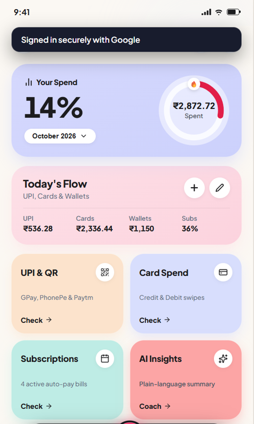

 

<table align="center">
  <tr>
    <td align="center" width="300">
      
    </td>
    <td width="560">
      
      

        Frontend developer and B.Tech student from India. 
        I like building clean, thoughtful web experiences, and I'm exploring how
        <b>Large Language Models</b> can power real products, especially at the
        intersection of <b>AI and SaaS</b>.
      

      

        
        
        
        
      

    </td>
  </tr>
</table>

  
   
  
   
  

<table align="center">
  <tr>
    <td align="center" width="300">
      
    </td>
    <td width="560">
      
      

        A mobile expense and budget tracker built for INR. It brings UPI, card
        and wallet spending into one calm, colorful dashboard, with subscription
        tracking and plain-language AI insights.
      

      

        
        
        
        
      

      
        <b>Inside:</b> spend overview by month &middot; UPI &amp; QR &middot; card spend &middot; subscriptions &middot; AI insights
      
    </td>
  </tr>
</table>

  
   
  

 

  

  

  

  

  
   
  
    
  

  
   
  
   
  

 

  <picture>
    <source media="(prefers-color-scheme: dark)" srcset="https://raw.githubusercontent.com/mohdhammad7780-dotcom/mohdhammad7780-dotcom/output/github-snake-dark.svg" />
    <source media="(prefers-color-scheme: light)" srcset="https://raw.githubusercontent.com/mohdhammad7780-dotcom/mohdhammad7780-dotcom/output/github-snake.svg" />
    
  </picture>

 

  

